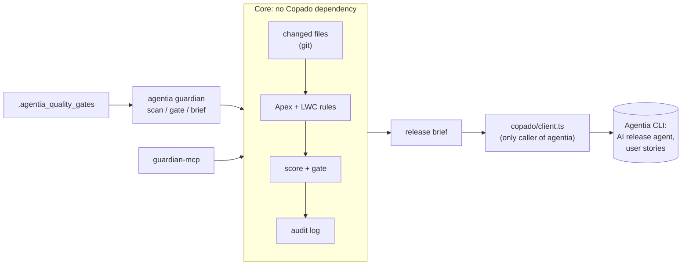

# Apex & LWC Guardian

A plugin for the **Copado Agentia CLI** that scans the Apex and Lightning Web Component files changed
on a user story, blocks risky changes before `agentia cicd work submit`, and writes a release brief
to the story.

## The problem

AI-generated and rushed Apex and LWC often contain governor-limit, security and testing risks: a
query inside a loop, a class without sharing, a hardcoded record ID, a test with no assertions, an
LWC that injects HTML. These are usually caught late, in a full scan or in production. Release
managers also get no consistent summary of what a change touches or how to roll it back.

Guardian checks only what changed, in seconds, gives the exact line and fix for each problem,
and plugs into the places changes already pass through: Agentia's pre-submit hook, CI, and AI
coding agents over MCP.

## Quick start

Needs Node.js 20+, git and the Agentia CLI (`npm install -g @copado/agentia-cli@beta`).

```sh
git clone <this repository> apex-lwc-guardian
cd apex-lwc-guardian
npm ci
npm run build
agentia plugins link .
```

Try it on the demo project (takes a minute, no Copado login needed):

```sh
node scripts/demo.mjs setup ../guardian-demo
cd ../guardian-demo
agentia guardian gate --story US-0001          # fails: 8 findings, exit code 1
node ../apex-lwc-guardian/scripts/demo.mjs fix .
agentia guardian gate --story US-0001          # passes, exit code 0
agentia guardian brief --story US-0001 --test-results .guardian/test-results.json
cat .guardian/briefs/US-0001.md .guardian/audit.jsonl
```

The full walkthrough is in [docs/demo-script.md](docs/demo-script.md).

## Commands

All commands work in any folder inside the project's git repository.

### `agentia guardian scan`

Scans the changed Apex and LWC files and prints the findings. Always exits 0 when the scan runs.

| Flag                                       | Meaning                                                                                                |
| ------------------------------------------ | ------------------------------------------------------------------------------------------------------ |
| `--base <ref>`                             | Branch to compare with. Default: `baseBranch` from the config (`main`); falls back to `origin/<base>`. |
| `--all`                                    | Scan every matching file, not only changed ones. Works without git.                                    |
| `--files a,b`                              | Scan exactly these files (relative to the current folder).                                             |
| `--format table\|json\|markdown`, `--json` | Output format. JSON has a stable schema (`schemaVersion: 1`).                                          |
| `--config <path>`                          | Config file. Default: `guardian.config.yml` in the repository root.                                    |

"Changed" means added, copied, modified or renamed in `<base>...HEAD`, plus uncommitted and
untracked changes, so an agent can check its edits before committing. Only `.cls`, `.trigger` and
`lwc/**/*.js|html` files are scanned.

### `agentia guardian gate`

Same scan and flags, plus `--story <id>`. Applies the thresholds from the config, appends a line to
the audit log, and exits:

| Exit code | Meaning                                                                                     |
| --------- | ------------------------------------------------------------------------------------------- |
| 0         | Passed                                                                                      |
| 1         | Blocking findings (severity at or above `failOn`), or risk score above `maxRiskScore`       |
| 2         | Usage or config error                                                                       |
| 3         | Environment error: not a git repository, no commits, base branch missing, git not installed |

With `--json`, errors are printed as `{"error": {"name", "message", "exitCode"}}`.

### `agentia guardian brief`

Writes a Markdown release brief: summary, changed components, risk findings, test status, rollback
plan (base commit, changed and added files, revert steps) and gate result.

| Flag                    | Meaning                                                                           |
| ----------------------- | --------------------------------------------------------------------------------- |
| `--story <id>`          | Required. User story ID or name.                                                  |
| `--base <ref>`          | As for `scan`.                                                                    |
| `--test-results <path>` | JSON from `sf apex run test --json`. Without it, test status says "not provided". |
| `--no-ai`               | Do not ask the Copado AI release agent; use the template summary.                 |
| `--attach`              | Also write the brief to the user story in Copado (see below).                     |
| `--out <path>`          | Output file. Default: `.guardian/briefs/<story>.md`.                              |
| `--json`                | Print the result (path, summary source, attached, warnings) as JSON.              |

The brief is always written locally. The AI is asked for the **summary paragraph only**, and only
file names, rule IDs, counts and finding messages are sent, never source code. If the AI is not
configured or fails, a template summary is used and the brief is still complete.

**`--attach`:** Agentia has no command to attach a file to a user story, so Guardian writes the brief
into the story's **Technical Specifications** field (`agentia cicd work update
--technical-specifications`). It reads the field first and replaces only its own section between
`<!-- guardian:start -->` and `<!-- guardian:end -->`, keeping everything else. If the story cannot
be read, nothing is written, a warning is printed and the local file is kept. See
[docs/BLOCKERS.md](docs/BLOCKERS.md) (B1, B3).

### `agentia guardian ui`

Opens a local web dashboard in your browser for the same scan, gate and brief, plus the audit
history and the effective rules and config. It calls the same core functions as the CLI, so results
match `--json` output exactly.

```sh
agentia guardian ui                    # http://localhost:4870/, opens the browser
agentia guardian ui --port 0 --no-open # pick a free port, print the URL only
npx guardian-ui ../guardian-demo       # without the Agentia CLI (after npm run build)
```

| View           | Shows                                                                                                                                           |
| -------------- | ----------------------------------------------------------------------------------------------------------------------------------------------- |
| Scan & gate    | Pass/fail verdict, risk score gauge, counts, and findings grouped by file with the source line, explanation and fix; filter by severity or text |
| Release brief  | Writes `.guardian/briefs/<story>.md` and renders it; copy or download the Markdown                                                              |
| Audit history  | Risk score per gate run, pass rate and every audit log entry                                                                                    |
| Rules & config | Thresholds, include and ignore paths, and each rule's effective severity and status                                                             |

The server listens on `127.0.0.1` only, answers only requests addressed to `localhost`, and accepts
changes (gate, brief) only as JSON, so other web pages cannot drive it. It reads source only for
`.cls`, `.trigger` and LWC files inside the project. Press Ctrl+C to stop it.

## Rules

16 rules. Details, examples and known limits for each are in [docs/rules.md](docs/rules.md).

| ID      | Severity | Detects                                                                      |
| ------- | -------- | ---------------------------------------------------------------------------- |
| APEX001 | error    | SOQL query inside a loop                                                     |
| APEX002 | error    | DML inside a loop                                                            |
| APEX003 | error    | HTTP callout inside a loop                                                   |
| APEX004 | warning  | Class has no sharing declaration                                             |
| APEX005 | error    | Hardcoded Salesforce record ID                                               |
| APEX006 | warning  | SOQL in `@AuraEnabled`/`@RestResource` class without user mode or FLS checks |
| APEX007 | warning  | Test method without assertions                                               |
| APEX008 | warning  | SOQL/DML or too much logic directly in a trigger                             |
| APEX009 | error    | `Trigger.new[0]` / `Trigger.old[0]`                                          |
| APEX010 | warning  | `@isTest(SeeAllData=true)`                                                   |
| APEX011 | warning  | Empty catch block                                                            |
| LWC001  | warning  | Imperative Apex call without error handling                                  |
| LWC002  | error    | `innerHTML` / `outerHTML` / `insertAdjacentHTML` / `lwc:inner-html`          |
| LWC003  | error    | `eval` or `Function` constructor                                             |
| LWC004  | warning  | Hardcoded record ID or absolute URL in LWC JavaScript                        |
| LWC005  | info     | `console.log` or `debugger` left in                                          |

**Risk score** (0-100): error 10, warning 3, info 1 per finding, capped at 100.

## Configuration

Optional `guardian.config.yml` in the repository root, validated on load (unknown keys and rule IDs
are errors). Full example: [guardian.config.example.yml](guardian.config.example.yml).

```yaml
baseBranch: main
include: ['force-app/**']
ignore: ['**/*.test.js', '**/__tests__/**', '**/node_modules/**']
rules:
  APEX004: {severity: error} # change a severity
  APEX011: {enabled: false} # switch a rule off
thresholds:
  failOn: error # error | warning
  maxRiskScore: 100
triggerMaxLines: 15 # APEX008
urlAllowList: [] # LWC004 allowed URL prefixes
audit: {enabled: true, path: .guardian/audit.jsonl}
```

**Audit log:** each `gate` run appends one JSON line with the timestamp, git user, story, base ref
and SHA, head SHA, files scanned, counts per severity, risk score, result, config hash and tool
version. It never holds source code.

**Slack (optional):** set `GUARDIAN_SLACK_WEBHOOK` to an `https` Slack incoming-webhook URL. When the
gate fails, Guardian posts the story, risk score and top 3 findings. A failed post never changes the
gate result.

## Run Guardian before every submit

Agentia runs a project-root script before `agentia cicd work submit` and `agentia cicd work test`,
and stops the submit if it exits non-zero. Copy the samples from
[examples/agentia-quality-gates/](examples/agentia-quality-gates/) into your Salesforce project:
`.agentia_quality_gates.cmd` (Windows) and `.agentia_quality_gates.sh` (macOS/Linux). They run
`agentia guardian gate` and pass its exit code through.

Users can bypass this with `--skip-local-tests`, so also run `agentia guardian gate` in CI.

## MCP server for AI agents

`guardian-mcp` is a stdio MCP server with three tools that return the same JSON as the CLI:
`guardian_scan`, `guardian_gate` and `guardian_brief`. Each takes an optional `cwd` (absolute path
of the project); otherwise the server uses `GUARDIAN_PROJECT_ROOT`, then `AGENTIA_PROJECT_ROOT`, then
its own folder. Agent instructions: [AGENTS.md](AGENTS.md) and
[skills/guardian/SKILL.md](skills/guardian/SKILL.md).

From source, run the bin with Node (replace `/abs/path/apex-lwc-guardian` with this folder). After
`npm install -g apex-lwc-guardian`, use `"command": "guardian-mcp"` with no args instead.

**Claude Code** ([docs](https://code.claude.com/docs/en/mcp)), from your Salesforce project:

```sh
claude mcp add --transport stdio --scope project guardian -- node /abs/path/apex-lwc-guardian/bin/guardian-mcp.js
```

or in the project's `.mcp.json`:

```json
{
  "mcpServers": {
    "guardian": {
      "type": "stdio",
      "command": "node",
      "args": ["/abs/path/apex-lwc-guardian/bin/guardian-mcp.js"]
    }
  }
}
```

**Cursor** ([docs](https://cursor.com/docs/mcp)), in `.cursor/mcp.json` or `~/.cursor/mcp.json`:

```json
{
  "mcpServers": {
    "guardian": {
      "type": "stdio",
      "command": "node",
      "args": ["/abs/path/apex-lwc-guardian/bin/guardian-mcp.js"],
      "env": {"GUARDIAN_PROJECT_ROOT": "${workspaceFolder}"}
    }
  }
}
```

Check that the server starts: `npm run build && npm run smoke:mcp -- /path/to/project`.

## Architecture



More detail: [docs/architecture.md](docs/architecture.md).

## Limitations

- Rules read one file at a time with a lightweight preprocessor, not a compiler. A loop that calls a
  method which runs a query is not reported. Each rule's limits are listed in
  [docs/rules.md](docs/rules.md).
- Rules prefer missing a rare case over flagging valid code, so a passing gate is a guard rail, not
  proof of safety. Copado's own quality gates still apply.
- The success responses of `ai agent ask`, `work get` and `work update` have not been checked against a
  real Copado org yet (no credentials during development). See [docs/BLOCKERS.md](docs/BLOCKERS.md) B3.
- The pre-submit hook can be skipped with `--skip-local-tests`; run the gate in CI as well.

## Roadmap

- Confirm the Copado payloads with real credentials (B3) and switch `--attach` to a real attachment
  API when Agentia offers one.
- Follow calls within a class for APEX001-003 (likely with `@apexdevtools/apex-parser`, loaded only
  for that rule).
- More rules: SOSL in loops, `Database.query` with string concatenation (SOQL injection),
  `@wire` without error handling, missing `@api` validation.
- A SARIF reporter for code-scanning dashboards.

## Development

```sh
npm run build       # compile to dist/ (linked plugins load dist/)
npm run lint        # ESLint + Prettier check
npm run typecheck   # src and test
npm test            # Vitest; no network, the Copado adapter is mocked
```

Project notes: [docs/agentia-notes.md](docs/agentia-notes.md) (verified Agentia CLI behaviour),
[docs/BLOCKERS.md](docs/BLOCKERS.md) (open items), [docs/parser-evaluation.md](docs/parser-evaluation.md).
