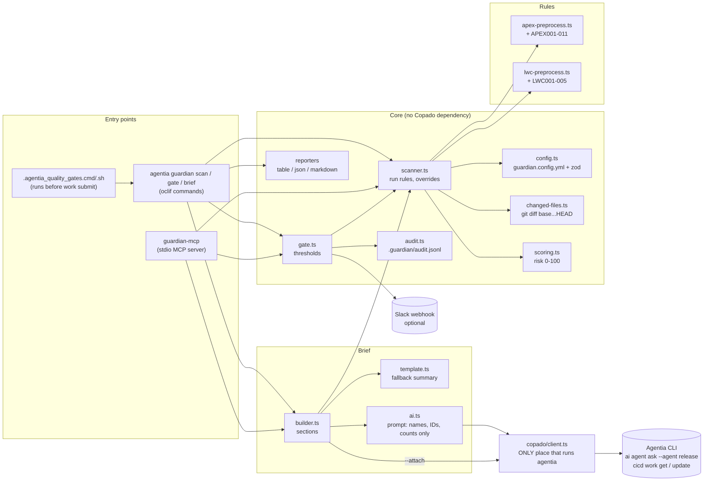

# Architecture

## Design rules

- **Rules engine independent of Copado.** `src/core` and `src/lang` read plain SFDX source and git. They
  run with no Copado login; `scan --all` works without git.
- **One adapter.** `src/copado/client.ts` is the only file that spawns `agentia`, with argument arrays,
  no shell, timeouts and `--json` parsing. It never throws. If Agentia changes, only it breaks.
- **Deterministic.** The same files and config give the same findings, score and brief. The AI only
  writes the summary paragraph, and the brief is complete without it.
- **Privacy.** Source code is never logged, sent to the AI or posted to Slack. Prompts carry file
  names, rule IDs, titles, finding messages and counts only (tested).
- **Lightweight analysis.** Preprocessors blank comments and strings, keep line numbers, and find
  loops, classes and methods. A full Apex parser was measured and not adopted
  ([parser-evaluation.md](parser-evaluation.md)).

## Data flow of `gate`

1. Load and validate `guardian.config.yml` (exit 2 on errors).
2. Find the repository root, resolve the base branch (or `origin/<base>`) and list changed files:
   `git diff --name-only --diff-filter=ACMR <base>...HEAD`, plus uncommitted and untracked files,
   filtered by `include`/`ignore` and file type (exit 3 if not a git repository or the base is missing).
3. Run the enabled rules for each file's language; apply severity overrides; score.
4. Apply `failOn` and `maxRiskScore`; print the report; append the audit line; notify Slack on failure.
5. Exit 0 (pass) or 1 (blocking findings).
